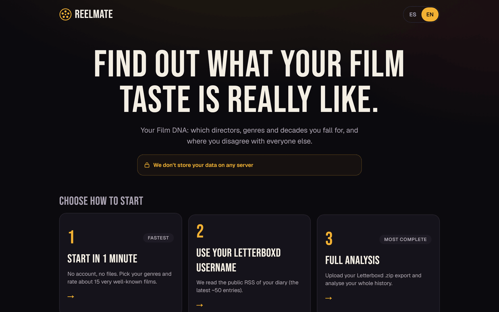
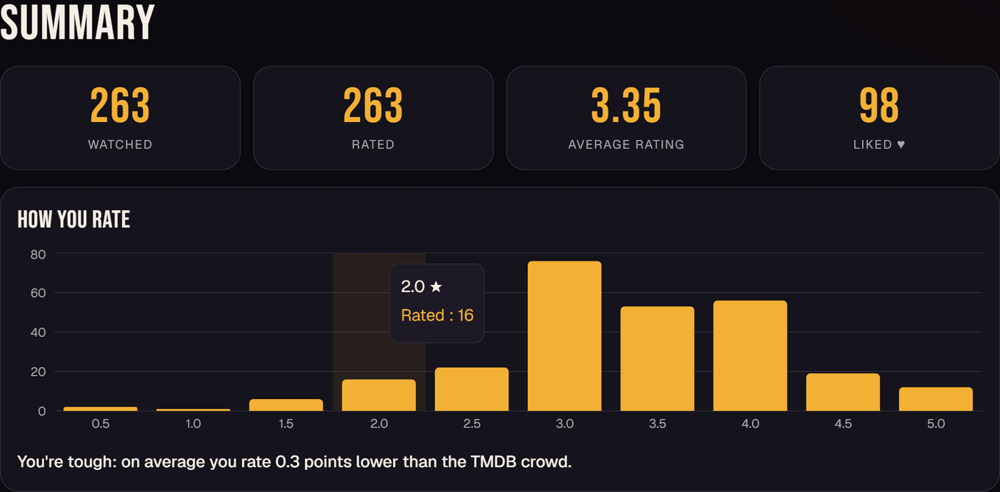
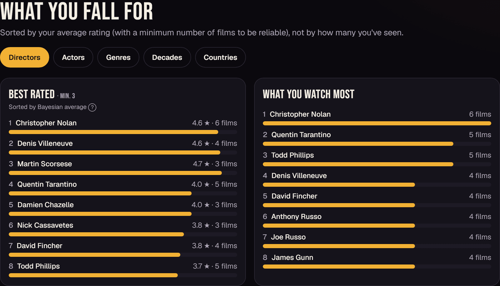
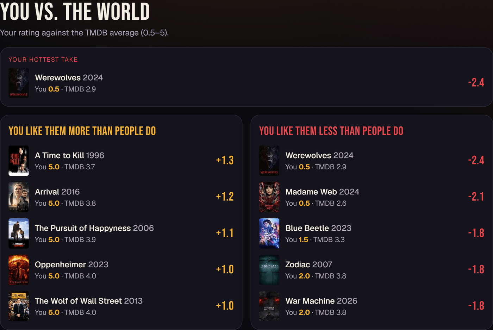
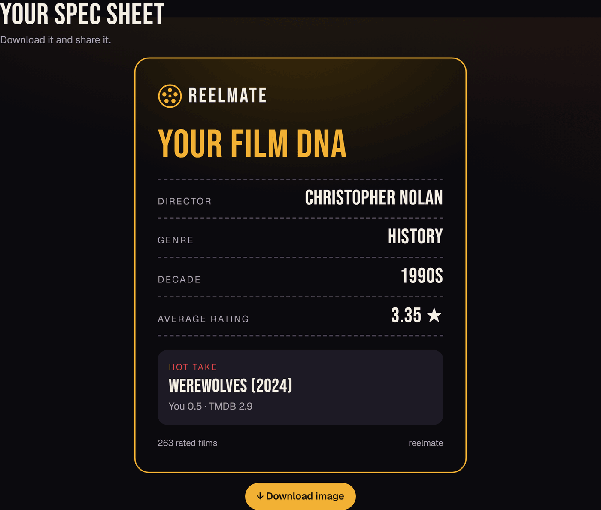
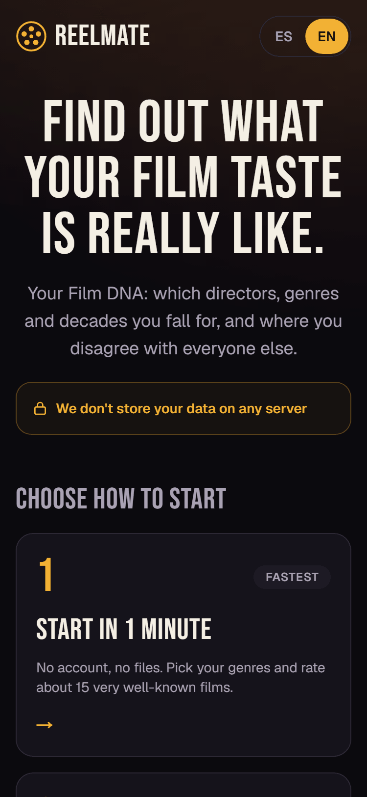

# Reelmate

**Find out what your film taste is really like.** Reelmate builds your *Film DNA* from your ratings: favourite directors, actors, genres, decades and countries (by Bayesian-adjusted average rating, not just by count), how you differ from the TMDB crowd, your rating quirks, your watchlist, and a shareable spec-sheet card.

> **We don't store your data on any server.** Letterboxd exports are parsed client-side in your browser. Only film titles and years reach the server (to be looked up on TMDB). Nothing is stored in a database.

**Live demo:** coming soon

## Screenshots

<p align="center">
  
</p>

| Summary | What you fall for |
|---|---|
|  |  |
| **You vs. the world** | **Spec sheet** |
|  |  |

<p align="center">
  
</p>

## Roadmap

| Phase | What | Status |
|------|------|--------|
| 1 | Film DNA dashboard (`web/`) | Done |
| 2 | Model that predicts the rating you would give a film (`analysis/` + `web/`) | Done |
| 3 | Group mode: pick a film with friends by swiping, Tinder-style | Planned |

## Three ways in

1. **Start in 1 minute** – pick genres and rate ~15 well-known films. No account.
2. **Letterboxd username** – reads the official public RSS (`letterboxd.com/USER/rss/`), only the latest ~50 *diary* entries. No other Letterboxd page is read.
3. **Full analysis** – drop the Letterboxd export `.zip` (Settings → Data → Export your data). Only `ratings.csv`, `watched.csv`, `watchlist.csv` and `likes/films.csv` are read.

A **See an example** link loads a sample profile.

## Structure

```
web/       Next.js (App Router) + TypeScript + Tailwind + Framer Motion + Recharts – deploys to Vercel
analysis/  Python research for Phase 2: dataset builder, features, models and the executed notebook
```

## Run locally

```bash
cd web
cp .env.example .env.local   # add your TMDB v3 API key as TMDB_API_KEY
npm install
npm run dev
npm test        # unit tests (the Python-equivalence test needs analysis/data/, see analysis/README.md)
```

The API key is only used by the server routes in `web/app/api/`; it is never sent to the browser.

## "How many stars would I give it?" (Phase 2)

Search any film and Reelmate predicts the rating you would give it (with its margin of error and the top reasons, e.g. *"+0.6 because it's by Christopher Nolan"*), and sorts your watchlist by predicted rating. **The model is trained in your browser (in a Web Worker) from your own ratings**; there is no model server and no database.

* **Research:** [`analysis/notebooks/01_rating_model.ipynb`](analysis/notebooks/01_rating_model.ipynb) compares baselines, Ridge, k-NN, Random Forest and Gradient Boosting with repeated cross-validation, target encoding computed inside each fold (no data leakage) and nested CV for Ridge (MAE 0.483★ vs 0.658★ for "always my mean" on 263 films; the TMDB-deviation baseline gets 0.517★). TMDB scores with few votes are shrunk towards the global mean (Bayesian adjustment) so a perfect 5.0 from one vote doesn't fool the model.
* **Model on the web:** Random Forest is the most accurate (0.473★) but only by ~0.005–0.010★ (not significant against Ridge's plain fit), so the web uses **Ridge** (additive → exact explanations, trains in milliseconds in TypeScript: [`web/lib/model.ts`](web/lib/model.ts)). A unit test checks that the TypeScript version reproduces the Python MAE on the same folds.
* **Per-user model choice:** below 30 ratings it uses a simple fallback (TMDB score shifted to your average + your genres). From 30 ratings on, it cross-validates both models on *your* ratings and uses the personal one if its error is lower than or equal to the fallback's (otherwise the fallback). Films with fewer than 100 TMDB votes are flagged as less reliable and ranked after the rest of your watchlist. The app always shows which one is active and its estimated accuracy ("±0.5 stars, within half a star for 6 out of 10 films").
* Only the text typed in the search box and film ids/titles reach the server (to query TMDB); your ratings never leave the browser.

## How rankings are ordered

"Best rated" lists (directors, actors, genres, decades, countries) only include groups with a minimum number of rated films (3 for directors/actors, 10 for genres/decades, 5 for countries) and are ordered by a **Bayesian average** so a perfect score over 3 films doesn't beat a great one over 20:

```
adjusted = (n · mean + m · C) / (n + m)
```

`n` = rated films in the group, `mean` = your real average for the group, `C` = your overall average, `m` = prior weight (3 for directors/actors, 5 for genres/decades/countries). The UI shows the real average but sorts by the adjusted one; the share card uses the same ranking. Constants live in `web/lib/stats.ts` (`MIN_RATED`, `PRIOR_M`).

## Privacy

- ZIP files are read in the browser (JSZip + PapaParse), never uploaded.
- The server receives titles/years (and the username for the RSS option) and stores nothing.
- Ratings and results can be cached in your browser (IndexedDB / localStorage). Use **Delete my data** to wipe them.

## Español

**Reelmate descubre cómo son de verdad tus gustos de cine.** A partir de tus puntuaciones genera tu *ADN de cine*: directores, actores, géneros, décadas y países ordenados por tu nota media ajustada (media bayesiana), tus diferencias con la media de TMDB, tus manías al puntuar, tu watchlist y una ficha técnica descargable para compartir.

**No guardamos tus datos en ningún servidor.** El .zip de Letterboxd se procesa en el navegador; al servidor solo llegan títulos y años (para buscarlos en TMDB) y, con la opción del RSS, el nombre de usuario. No hay base de datos.

Tres formas de entrar: puntuar 15 películas en 1 minuto, usar tu usuario de Letterboxd (RSS público, ~50 últimas entradas del diario) o subir la exportación completa en .zip. Fase 2 (hecha): «¿Cuánto le pondría yo?», un modelo que se entrena en tu navegador con tus notas, predice la nota de cualquier película con sus motivos y ordena tu watchlist (investigación en `analysis/`). Fase futura: modo grupo tipo Tinder (fase 3).

## Credits

Film data and posters: [TMDB](https://www.themoviedb.org). This product uses the TMDB API but is not endorsed or certified by TMDB.
